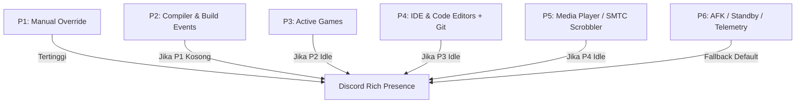

<div align="center">

# 🌌 OmniPresence

**Autonomous, Multi-Context Discord Rich Presence & Process Watcher Suite**

[](https://www.python.org/)
[-41CD52.svg?style=for-the-badge&logo=qt&logoColor=white)](https://www.qt.io/)
[](https://discord.com)
[](https://microsoft.com/windows)
[](LICENSE)

<p align="center">
  OmniPresence memantau aktivitas sistem operasi secara dinamis, mengekstrak konteks mendalam (Git branches, compiler subprocess, Windows media session, hardware metrics), lalu menyinkronkannya ke Discord Rich Presence melalui IPC socket berkecepatan tinggi dengan antarmuka desktop frameless bergaya Linear & Raycast.
</p>

[Fitur Utama](#-fitur-utama) • [Hierarki Prioritas](#-hierarki-prioritas-engine) • [Instalasi](#-instalasi--penggunaan) • [Konfigurasi](#-konfigurasi-rulesjson) • [Tech Stack](#-arsitektur--tech-stack)

---

</div>

## ✨ Fitur Utama

- 🎨 **Artisanal Modern UI (Raycast & Linear Aesthetic):** Antarmuka frameless ultra-dark (`#0a0c10`) dengan typography-first design, live hardware telemetry, dan **1:1 Live Discord Profile Card Mockup** langsung di dalam aplikasi.
- ⚡ **Zero Subprocess Git Tracker:** Membaca `.git/HEAD` dan referensi lokal langsung tanpa spawn shell command berulang, menampilkan nama branch aktif dan status repositori pada Discord status.
- 🔨 **Active Compiler & Build Listener:** Otomatis mendeteksi saat compiler (`gcc`, `g++`, `clang`, `make`, `ninja`, `cargo`, `rustc`, `cmake`, `msbuild`) sedang aktif dan menaikkan status menjadi build mode dengan durasi linger cerdas.
- 🎵 **Native Windows SMTC Scrobbler:** Membaca metadata musik (judul lagu, artis, timeline progress) dari Spotify, Apple Music, YouTube (Chrome/Brave/Edge) via Windows System Media Transport Controls tanpa membutuhkan API token pihak ketiga.
- 🛡️ **Resilient IPC Auto-Reconnect:** Koneksi ke socket Discord IPC (`\\.\pipe\discord-ipc-0`) dilengkapi exponential backoff dan sliding-window rate limit, anti-crash saat Discord dibuka-tutup.
- 🎛️ **Full System Tray & Background Worker:** Minimize to tray, context action menu, quick rule reloading, dan sinkronisasi Windows Startup Registry.

---

## 🧭 Hierarki Prioritas Engine

OmniPresence menggunakan mesin penengah prioritas (*Priority Arbitration Engine*) bertingkat untuk memastikan status yang paling relevan selalu ditampilkan ke profil Discord Anda:



| Tier | Kategori | Contoh Trigger | Output Status |
| :---: | :--- | :--- | :--- |
| **P1** | **Manual Override** | Input manual dari Quick Controls bar | Mengunci status kustom teratas |
| **P2** | **Compiler Listener** | `gcc.exe`, `g++.exe`, `cargo.exe`, `ninja.exe` | `Compiling: main.cpp` + Build badge |
| **P3** | **Game Session** | Fullscreen games, Minecraft, Steam titles | Mode gaming & play session timer |
| **P4** | **IDE & Workspaces** | Code::Blocks, VS Code, Neovim | `Editing: app.cpp` • `Git: main` |
| **P5** | **Media Scrobbler** | Spotify, YouTube Music, Browser tabs | `Listening to: Track - Artist` + elapsed |
| **P6** | **Idle & AFK** | Mouse/Keyboard idle > 5 menit | `AFK / Away from desk` |

---

## 🚀 Instalasi & Penggunaan

### Prasyarat
- **Windows 10 / 11** (64-bit)
- **Python 3.11** atau lebih baru
- Klien resmi **Discord Desktop** (atau Vesktop dengan arRPC aktif)

### 1. Clone Repositori
```bash
git clone https://github.com/Raf446/OmniPresence.git
cd OmniPresence
```

### 2. Pasang Dependensi
```powershell
python -m pip install -r omnipresence\requirements.txt
```

### 3. Konfigurasi Discord Application ID
1. Buka [Discord Developer Portal](https://discord.com/developers/applications) dan buat **New Application** (contoh nama: `OmniPresence` atau `Code::Blocks`).
2. Salin **Application ID**.
3. Buka tab **Rich Presence** $\rightarrow$ **Art Assets**, upload logo aset yang kamu inginkan (misal key: `codeblocks_logo`, `vscode_logo`, `spotify_logo`).

### 4. Menjalankan Aplikasi
```powershell
# Mode GUI Standar
python omnipresence\main.py

# Mode Langsung ke System Tray (Background)
python omnipresence\main.py --minimized

# Menjalankan dengan Client ID langsung via CLI
python omnipresence\main.py --client-id MASUKKAN_APPLICATION_ID_KAMU
```

> **Tips:** Kamu juga bisa memasukkan Application ID langsung dari input box di header UI aplikasi, lalu klik **Apply App ID** untuk menyimpannya secara otomatis ke `settings.json`.

---

## ⚙️ Konfigurasi (`rules.json`)

Aturan pemetaan aplikasi dikelola sepenuhnya melalui file deklaratif `omnipresence/config/rules.json`. Setiap rule mendukung ekspresi reguler dinamis:

```json
{
  "id": "codeblocks_editor",
  "name": "Code::Blocks IDE",
  "priority": "P4",
  "process_names": ["codeblocks.exe"],
  "title_regex": "^(?:\\[(?P<target>[^\\]]+)\\]\\s+)?(?P<file>.+?)\\s+-\\s+Code::Blocks.*$",
  "presence": {
    "details": "Editing: {file}",
    "state": "Project: {target|Workspace}",
    "large_image": "codeblocks_logo",
    "large_text": "Code::Blocks IDE",
    "small_image": "git_badge",
    "small_text": "Git: {git_branch}"
  }
}
```

---

## 🛠️ Arsitektur & Tech Stack

```
omnipresence/
├── assets/styles/theme.qss    # QSS dark theme (Zinc/Slate #0a0c10)
├── config/                    # settings.json & rules.json
├── core/
│   ├── ipc_manager.py         # Discord IPC resilient pipe handler
│   ├── priority_engine.py     # Hierarchical rule match & string interpolator
│   ├── process_watcher.py     # Win32 ForegroundHook & delta process scanner
│   └── state_manager.py       # Centralized Qt reactive signals store
├── extractors/
│   ├── compiler_listener.py   # Subprocess detector (gcc, g++, make, ninja, dll.)
│   ├── git_extractor.py       # Direct .git metadata parser
│   ├── media_scrobbler.py     # Windows SMTC media transport reader
│   └── telemetry.py           # CPU & RAM exponential moving average sampler
├── ui/
│   ├── main_window.py         # Frameless window dengan native window movement
│   ├── tray_manager.py        # System tray icon & contextual menu
│   └── components/            # Live Discord preview card, Quick controls, Rules table
└── main.py                    # Application bootstrap
```

- **GUI Toolkit:** [PySide6 (Qt for Python)](https://wiki.qt.io/Qt_for_Python)
- **Discord IPC Protocol:** [pypresence](https://github.com/qwertyquill/pypresence)
- **OS Telemetry & Hooks:** `psutil`, `winsdk`, `ctypes` (Win32 API)

---

## 🤝 Kontribusi

Kontribusi selalu terbuka! Silakan lakukan fork pada repositori ini, buat feature branch baru, dan kirimkan Pull Request:

1. Fork repositori ini
2. Buat branch fitur kamu (`git checkout -b feature/amazing-feature`)
3. Commit perubahan kamu (`git commit -m 'feat: add amazing new feature'`)
4. Push ke branch kamu (`git push origin feature/amazing-feature`)
5. Buka Pull Request

---

## 📄 Lisensi

Didistribusikan di bawah Lisensi **MIT**. Lihat `LICENSE` untuk informasi lebih lanjut.

<div align="center">
  <sub>Dibangun dengan dedikasi untuk komunitas developer & power-users.</sub>
</div>
