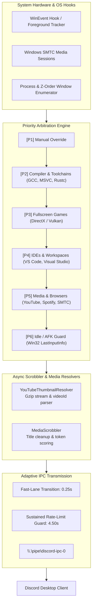

<div align="center">

# OmniPresence

**High-Performance, Multi-Context Discord Rich Presence Engine for Windows**

[](https://github.com/Raf446/OmniPresence/releases)
[](#)
[](#)
[-41CD52.svg?style=flat-square)](#)
[](#)

</div>

---

## ⚡ Overview

**OmniPresence** is an automated, intelligent Discord Rich Presence suite for Windows that resolves concurrent activity conflicts through deterministic **tiered priority arbitration**. It continuously evaluates active toolchains, full-screen games, IDEs, browser video streams, and OS-level media sessions in real time with sub-second transition latency.

Featuring an asynchronous worker pool (`QThreadPool`), OmniPresence fetches and caches high-definition album art and YouTube video thumbnails on the fly with **zero API keys required**.

---

## 🏗️ Architecture Pipeline



---

## 🌟 Key Capabilities

### 1. Zero-Key YouTube Thumbnail Resolver

* **High-Res Thumbnail Extraction:** Resolves `hqdefault.jpg` thumbnails directly via lightweight gzip stream parsing (~160 KB payload, <900ms) without requiring Google Cloud / YouTube API credentials.
* **Window Noise Stripping:** Strips audio glyphs (`▶`, `🔊`), zero-width Unicode characters (`\u200b`), unread badges `(1)`, and browser suffixes (`- Brave`, `- Google Chrome`, `- Microsoft Edge`, `— Mozilla Firefox`).
* **Fallback Navigation States:** Cleanly presents states such as `"Browsing YouTube"` or `"Browsing YouTube (Subscriptions)"` when browsing feeds.

### 2. Music Artwork & Metadata Sanitization

* **Noise Filter:** Strips bracketed metadata (`[Official Video]`, `(Remastered)`, `(From "OST")`) and long collaborator strings (`feat.`, `with`) before querying artwork endpoints.
* **Candidate Scoring Engine:** Uses `difflib.SequenceMatcher` with a strict `0.58` acceptance threshold to automatically reject tribute bands, karaoke tracks, and unrelated covers.

### 3. Preemptive Z-Order Context Arbitration

* **Foreground Preemption:** Active foreground applications immediately override sticky background IDE contexts (`foreground=True` beats `foreground=False`).
* **Fast-Lane IPC Dispatch:** Rule and track transitions update within `0.25s` while maintaining Discord's 4 req / 20s rate-limit boundary.

---

## 📊 Priority Hierarchy Matrix

| Tier | Classification | Trigger Scope | Eviction & Sticky Behavior |
| --- | --- | --- | --- |
| **P1** | **Manual Override** | UI Action Bar override toggle | Overrides all activities until disengaged. |
| **P2** | **Toolchain / Build** | `gcc`, `cl`, `rustc`, `cargo`, `ninja` | Active while process exists; evicted upon link completion. |
| **P3** | **Fullscreen Games** | Process list & exclusive fullscreen | Retains screen focus; prevents media from covering gameplay. |
| **P4** | **IDEs & Editors** | `code.exe`, `devenv.exe`, `codeblocks.exe` | Foreground focus with configurable sticky cooldown buffer. |
| **P5** | **Media & Browsers** | YouTube (Brave/Chrome/Edge), Spotify, SMTC | Displays active track/video with validated cover or thumbnail. |
| **P6** | **Idle / AFK** | `GetLastInputInfo()` > 300s | Enters standby when no hardware input is detected. |

---

## 📁 Repository Layout

```
OmniPresence/
├── assets/               # Application icons, styling, and vector assets
├── config/
│   └── rules.json        # Declarative detection rules, regex, and tier bindings
├── core/
│   ├── ipc_manager.py    # Discord IPC socket client & rate-limiting pipe handler
│   ├── priority_engine.py# Hierarchy evaluator, template parser, and context arbiter
│   ├── process_watcher.py# WinEvent foreground hook & Z-order window scanner
│   └── state_manager.py  # Application lifecycle & Qt signal coordinator
├── extractors/
│   ├── media_scrobbler.py# Windows SMTC extractor & artwork candidate scorer
│   └── youtube_resolver.py# Async zero-key YouTube thumbnail resolver
├── ui/
│   ├── discord_preview.py# Real-time Discord card preview widget
│   └── main_window.py    # Control surface UI & live activity telemetry
├── build.bat             # Production one-file PyInstaller build script
├── build_exe.py          # PyInstaller build spec & Windows binary metadata
├── main.py               # Entrypoint & Qt application loop
└── requirements.txt      # Core runtime dependencies

```

---

## 🚀 Quick Start

### Prerequisites

* Windows 10 or 11 (64-bit)
* Python 3.11+ (for development run)
* Discord Desktop Client

### Development Setup

```powershell
# 1. Clone repository
git clone [https://github.com/Raf446/OmniPresence.git](https://github.com/Raf446/OmniPresence.git)
cd OmniPresence

# 2. Set up virtual environment
python -m venv .venv
.\.venv\Scripts\Activate.ps1
pip install -r requirements.txt

# 3. Verify engine integrity
python main.py --smoke-test 2.0

# 4. Launch OmniPresence
python main.py

```

### Standalone Executable Build

To compile a standalone binary that runs without a local Python runtime:

```powershell
.\build.bat

```

The compiled binary will be placed at `dist\OmniPresence.exe` with bundled configuration files.

---

## 📄 License

Distributed under the [MIT License](mit_license). Free for personal and commercial usage.
