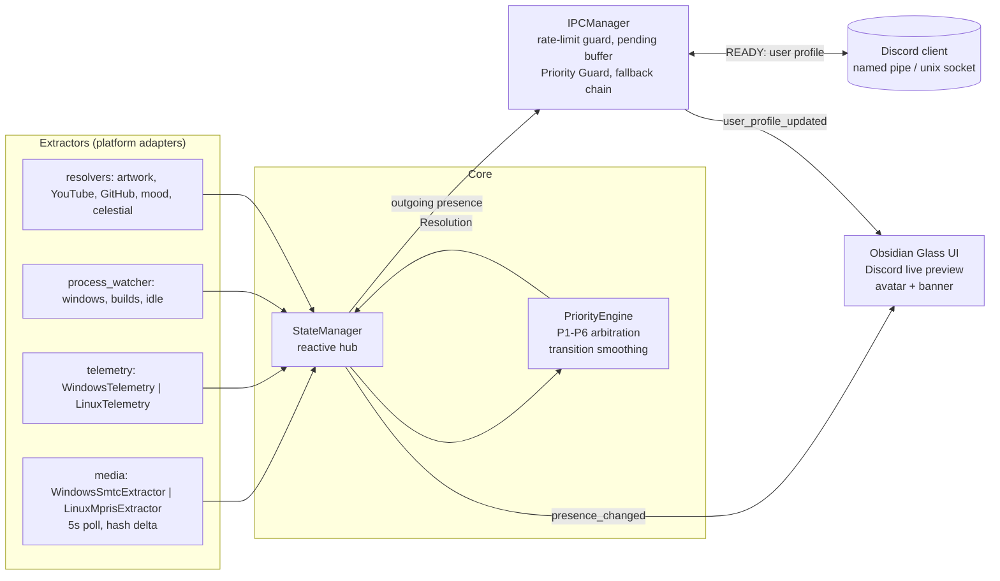

<div align="center">

# OmniPresence

**Autonomous, multi-context Discord Rich Presence engine for Windows and Linux.**

[](https://github.com/Raf446/OmniPresence/releases)
[](mit_license.md)
[](#cross-platform-native-subsystems)
[](#build-from-source)
[-41CD52.svg?style=flat-square)](#rich-obsidian-glass-ui--discord-live-mirror)

</div>

---

## Overview

OmniPresence watches everything you do on your machine (compilers, games, editors, music, browser tabs, idle time) and decides, in real time, **which single context deserves your Discord profile**. A deterministic six-tier arbitration engine replaces the usual "last writer wins" behavior of single-purpose presence tools, and a rate-limit-aware IPC layer keeps the card stable without ever tripping Discord's 5-updates-per-20-seconds budget.

> **Ringkasan (ID):** OmniPresence adalah engine Discord Rich Presence otomatis untuk Windows dan Linux. Satu codebase, dua backend native (Windows SMTC dan Linux MPRIS2/D-Bus + `/proc`), arbitrasi prioritas P1-P6, polling media 5 detik anti-flapping, tombol interaktif Spotify/Genius, serta preview kartu Discord live lengkap dengan avatar dan banner asli akun kamu.

---

## Key Highlights & Features

### Tiered Priority Arbitration Engine (P1-P6)

Every scan produces a set of live candidates. The engine ranks them by tier, then by foreground state, then by rule order, and renders exactly one winner.

| Tier | Context | Typical trigger | Behavior |
| :--- | :--- | :--- | :--- |
| **P1** | Manual / Privacy Shield | Custom RPC toggle, `Win+L`, inactivity timeout | Locks your chosen (or stealth) status and outranks everything below. |
| **P2** | Build | `gcc`, `cl`, `cargo`, `ninja` | Active while the toolchain runs, released the moment it exits. |
| **P3** | Game | Full-screen DirectX/Vulkan windows | Prevents media or IDE status from overwriting a game. |
| **P4** | Editor | VS Code, Visual Studio, Code::Blocks | Shows workspace and language while the editor is foreground. |
| **P5** | Media | Spotify, Apple Music, YouTube in a browser | Track, artist, cover art, mood badge and interactive buttons. |
| **P6** | Idle / Standby | No input past the threshold | Live CPU/RAM telemetry with celestial and weather context. |

Stability guarantees built into the pipeline:

- **Media transition smoothing:** the engine holds the last P5 candidate through a short transition window, so a skipped track can never flash P6.
- **IPC Priority Guard:** while Discord's rate-limit cooldown is active, a P6 payload is never allowed to overwrite a pending P5 payload; the newest track is always the one delivered when the window opens.
- **Foreground preemption:** context switches use a burst lane (0.25 s) while sustained updates stay spaced at 5 s.

### Cross-Platform Native Subsystems

One repository, one codebase, platform adapters selected lazily from `sys.platform`. Only the backend for the running OS is ever imported, so `dbus` is never loaded on Windows and `winsdk` is never loaded on Linux.

| Concern | Windows 10/11 | Linux |
| :--- | :--- | :--- |
| Media detection | **SMTC** via `winsdk` (`GlobalSystemMediaTransportControlsSessionManager`) | **MPRIS2** over the D-Bus session bus (`org.mpris.MediaPlayer2.*`: `xesam:title`, `xesam:artist`, `xesam:album`, `mpris:artUrl`) |
| CPU / RAM telemetry | `psutil` | Zero-overhead parsing of `/proc/stat` (CPU delta) and `/proc/meminfo` (`MemTotal - MemAvailable`) |
| Discord IPC | Named pipe `\\.\pipe\discord-ipc-N` | Unix domain socket `$XDG_RUNTIME_DIR/discord-ipc-N` (also Flatpak and Snap sub-paths) |

The Linux backend is covered by a hermetic mock suite (`tests/test_linux_backend.py`) that fakes the D-Bus interface and the `/proc` virtual files, so it runs on any OS, including Windows CI.

### Smart Media Scrobbler & Interactive RPC

- **5-second periodic polling, anti-flapping by design:** no per-event SMTC listeners. Each tick reads the active session, hashes `artist + title`, and stays completely silent when the hash is unchanged, which saves Discord IPC quota.
- **Smart hash delta:** a changed hash triggers metadata extraction, artwork resolution and a single `media_changed` emission. Rapid multi-skips collapse into whichever track is playing at the next tick.
- **Graceful stop:** playback is declared stopped only after **two consecutive empty ticks (10 s)**, so the engine falls back to Standby smoothly instead of flickering.
- **Interactive buttons:** *Listen on Spotify* deep-links to the exact track when its ID is known (Linux MPRIS exposes it), otherwise to a Spotify search; *Lyrics on Genius* opens a Genius search. Labels are capped at 32 characters, URLs at 512, and queries are shrunk to fit.
- **Graceful degradation:** if Discord rejects a payload, the IPC layer retries without buttons, then with a bundled icon instead of external artwork, so presence delivery never fails outright.
- **Zero-key artwork:** iTunes and Deezer lookups with fuzzy scoring and tribute/karaoke rejection; no API key or developer account needed.

### Rich Obsidian Glass UI & Discord Live Mirror

- **Live Discord card preview** that mirrors exactly what friends will see, including your **real avatar** (circular mask, animated avatars supported) and **banner** fetched from the Discord CDN straight from the IPC `READY` payload. Users without a custom banner get their accent color as an elegant gradient.
- Asynchronous image loading through `QNetworkAccessManager`, so the UI never blocks.
- Adaptive Mood Engine (HSL palette classification of cover art), Celestial Sync (solar/lunar phase and weather), Privacy Shield, daily analytics, and a frameless collapsible-sidebar window built on PySide6.
- Official gateway Application ID out of the box, with a custom ID option, plus an in-app auto-updater driven by GitHub Releases.

---

## Architecture



```text
Extractors ──> StateManager ──> PriorityEngine ──> StateManager ──┬──> IPCManager ──> Discord
 (SMTC/MPRIS,   (reactive hub)   (P1-P6 winner)    (dedupe)       │      ^   (named pipe / unix socket)
  /proc, WinAPI)                                                  └──> UI  └── READY user, avatar, banner
```

### Repository layout

```text
OmniPresence/
├── core/
│   ├── ipc_manager.py        # Discord IPC, rate limiting, profile extraction, fallback chain
│   ├── priority_engine.py    # P1-P6 arbitration, templates, smart buttons
│   ├── state_manager.py      # Reactive state hub
│   └── updater.py            # GitHub Releases auto-updater
├── extractors/
│   ├── media/                # base.py, windows_smtc.py, linux_mpris.py, links.py, common.py
│   ├── telemetry/            # base.py, windows_telemetry.py, linux_telemetry.py
│   └── ...                   # artwork, mood, celestial, YouTube/GitHub resolvers
├── ui/                       # PySide6 window and live Discord preview
├── tests/                    # Hermetic suites (Linux backend runs on Windows via mocks)
├── installer/installer.iss   # Inno Setup script
└── main.py                   # Entrypoint
```

---

## Installation

### Binary installer (Windows)

1. Download **`OmniPresence-Setup-v2.4.exe`** from [Releases](https://github.com/Raf446/OmniPresence/releases).
2. Run it. It is a per-user install and needs no administrator rights.
3. Launch OmniPresence from the Desktop or Start Menu. It connects to Discord automatically and checks for updates in the background.

### Build from source

Requires **Python 3.11+**.

```powershell
git clone https://github.com/Raf446/OmniPresence.git
cd OmniPresence

python -m venv .venv
.\.venv\Scripts\Activate.ps1
pip install -r requirements.txt

python -m unittest tests/test_linux_backend.py   # hermetic test suite
python main.py --smoke-test 2.0                  # headless startup check
python main.py                                   # run the app
```

Linux media detection additionally needs `dbus-python` (`pip install dbus-python`, or your distro's `python3-dbus`) and a session bus.

### Build the standalone executable and installer (Windows)

```powershell
.\build.bat                                      # PyInstaller -> dist\OmniPresence.exe
# Then open installer\installer.iss in Inno Setup 6 and press Ctrl+F9
# -> dist_installer\OmniPresence-Setup-v2.4.exe
```

---

## Credits & Author

Designed and built by **[Raf446](https://github.com/Raf446)**.

Built with [PySide6](https://doc.qt.io/qtforpython/), [pypresence](https://github.com/qwertyquerty/pypresence), [psutil](https://github.com/giampaolo/psutil) and [winsdk](https://github.com/pywinrt/python-winsdk). Cover art is resolved through the public iTunes and Deezer search APIs; Discord, Spotify, Genius and Apple Music are trademarks of their respective owners and are not affiliated with this project.

Released under the [MIT License](mit_license.md).
