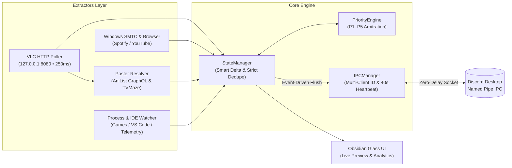

<div align="center">

# OmniPresence `v2.4.1`

**Aplikasi Discord Rich Presence Cerdas, Ringan, dan Reaktif untuk Windows.**

[](https://github.com/Raf446/OmniPresence/releases)
[](mit_license.md)
[](#panduan-instalasi--penggunaan-development)
[](#prasyarat--konfigurasi-eksternal)
[](#pengujian-otomatis-testing)
[](#zero-delay--rate-limit-immune-architecture)

</div>

---

## Ringkasan Proyek

**OmniPresence v2.4.1** adalah mesin otomasi **Discord Rich Presence** generasi terbaru untuk Windows yang mendeteksi aktivitas sistem secara *real-time*—mulai dari pemutaran anime/film di **VLC Media Player**, musik di **Spotify**, tontonan **YouTube**, sesi pemrograman di **VS Code**, hingga aktivitas **Gaming**—dan menampilkannya ke profil Discord Anda dengan akurasi tinggi.

Dirancang dengan arsitektur **Event-Driven IPC** dan **Dynamic Multi-Client ID Switching**, OmniPresence merespons transisi *Play/Pause* atau *Seek* secara instan (`250ms` polling) tanpa memicu *rate-limit throttling* dari Discord Client.

---

## Fitur Utama (*Key Features*)

### 1. Dynamic Priority Tier Engine (P1–P5)
OmniPresence menggunakan mesin arbitrasi berjenjang deterministik untuk memastikan hanya satu konteks aktivitas terpenting yang tampil di profil Discord Anda setiap saat:

| Tier | Kategori Aktivitas | Contoh Aplikasi / Pemicu | Perilaku Prioritas |
| :--- | :--- | :--- | :--- |
| **P1** | **Manual Override & Privacy Shield** | Custom Status Toggle, `Win+L`, Stealth Mode | Mengunci status kustom atau menyembunyikan aktivitas; mengesampingkan seluruh tier di bawahnya. |
| **P2** | **Build & Compiler Toolchain** | `gcc`, `clang`, `cargo`, `ninja`, `msbuild` | Aktif otomatis saat kompilasi berlangsung dan langsung dilepas ketika proses selesai. |
| **P3** | **Gaming & Launchers** | Game DirectX/Vulkan Fullscreen, Steam, Epic | Mencegah pemutar musik atau IDE menimpa status game yang sedang dimainkan. |
| **P4** | **Developer Tools & IDE** | Visual Studio Code, Visual Studio, Code::Blocks | Menampilkan nama *workspace*, file aktif, dan bahasa pemrograman saat sedang *coding*. |
| **P5** | **Media Players (Hierarki Ketat)** | **VLC Media Player** $\rightarrow$ **YouTube** $\rightarrow$ **Spotify** $\rightarrow$ *Media Lain* | Menampilkan judul media, poster/artwork dinamis, progress bar waktu nyata, dan tombol interaktif. |
| **P6** | **Idle / Standby Telemetry** | Sistem tanpa aktivitas di atas ambang batas | Menampilkan telemetri CPU/RAM ringan beserta fase waktu/cuaca (*Celestial Sync*). |

> **Hierarki Internal P5 (Media):**
> Di dalam grup **P5**, OmniPresence menerapkan urutan prioritas tegas:
> 1. **VLC Media Player** (`vlc-video` / `vlc-audio`) — *Prioritas tertinggi di P5*
> 2. **YouTube (Browser)** (`youtube-browser`)
> 3. **Spotify** (`spotify`)
> 4. **Media Session Lainnya** (Apple Music, SMTC/MPRIS umum)

---

### 2. Full Media Integration (VLC, Spotify, YouTube)

- **VLC Media Player (Direct HTTP Web Interface — 250ms Polling)**
  - Membaca status pemutaran langsung dari endpoint bawaan VLC (`http://127.0.0.1:8080/requests/status.json`) setiap **250ms** di *background thread* dengan *overhead* CPU mendekati `0%`.
  - Mendeteksi penekanan tombol `Space` (*Play/Pause*), pergantian episode/file, dan *manual seek* secara instan tanpa bergantung pada judul jendela Windows yang tidak stabil.
- **Dynamic Online Poster Fetcher (AniList & TVMaze)**
  - Membersihkan judul file secara otomatis dari tag grup rilis, nomor episode, dan resolusi (contoh: `"[SubGroup] Clannad BD - 01 [1080p].mkv"` $\rightarrow$ `"Clannad"`).
  - Mencari poster resmi beresolusi tinggi secara non-blocking melalui **AniList GraphQL API** (untuk anime) dengan *fallback* otomatis ke **TVMaze API** (untuk serial TV/film barat) serta dukungan *in-memory TTL cache*.
  - Jika koneksi offline atau poster tidak ditemukan, aset otomatis kembali (*graceful fallback*) ke ikon bawaan **`vlc`**.
- **Custom Paused State (`large_image: "pause"`)**
  - Saat pemutaran VLC dijeda (*Paused*), OmniPresence mempertahankan koneksi RPC tetap hidup, menghapus kalkulasi waktu berjalan agar bar durasi berhenti, menampilkan gambar utama **`pause`**, dan memperbarui status menjadi `"Paused"`.
- **Spotify & Browser (YouTube)**
  - Sinkronisasi otomatis melalui **Windows SMTC** (*System Media Transport Controls*) dan ekstraktor konteks browser.
  - Dilengkapi pencarian sampul album otomatis (iTunes & Deezer API tanpa kunci API) serta tombol interaktif (*Listen on Spotify*, *Lyrics on Genius*, *Watch on YouTube*).

---

### 3. Dynamic Multi-Client ID Switching
OmniPresence secara otomatis mengganti **Discord Application ID** di balik layar (*seamless IPC re-handshake*) sesuai jenis media atau aktivitas yang sedang menang di Priority Engine—tanpa perlu memasukkan Client ID secara manual di menu pengaturan:

| Konteks Aktivitas | Tampilan Header Discord | Application ID Bawaan |
| :--- | :--- | :--- |
| **VLC Media Player** | *Watching **VLC Media Player*** | `1563538304593436712` |
| **YouTube** | *Watching **YouTube*** | `1562111104556204112` |
| **Spotify** | *Listening to **Spotify*** | `1562111027104063568` |
| **Default (Coding / Gaming / Idle)** | *Playing / Using **OmniPresence*** | `1560465175188996176` |

---

### 4. Zero-Delay & Rate-Limit Immune Architecture
Dirancang khusus untuk menghindari pembatasan kuota Discord IPC (*5 updates per 20 seconds*):

- **Murni Event-Driven & Strict Deduplication (`_last_pushed_payload`)**:
  - Paket IPC **hanya** dikirim saat terjadi perubahan nyata: transisi **Play $\leftrightarrow$ Pause**, lompatan waktu manual (**Seek > 2.0 detik**), atau pergantian lagu/video/aplikasi.
  - Jika payload detik ini identik dengan payload sebelumnya (baik saat `playing` linear maupun saat `paused`), pengiriman dibatalkan sepenuhnya sehingga tidak ada *spam* log `[OK] presence sent` setiap detik.
- **Native Discord Timestamp Animation**:
  - Memanfaatkan pasangan epoch `start` dan `end` bawaan Discord Client sehingga bar durasi bergerak mulus secara lokal di sisi Discord tanpa perlu mengirim paket pembaruan setiap detik.
- **Safe 40-Second Heartbeat (`HEARTBEAT_INTERVAL = 40.0s`)**:
  - Sinkronisasi berkala setiap **40 detik** hanya dijalankan ketika media sedang berstatus **`playing`** untuk menjaga presisi waktu jangka panjang.
  - Saat media berstatus **`paused`**, tidak ada pengiriman periodik sama sekali hingga pengguna menekan tombol *Play* kembali.

---

### 5. Desktop UI & Controls (*Obsidian Glass UI*)
- **Live Discord Profile & Card Preview**: Menampilkan pratinjau kartu Rich Presence secara *real-time* lengkap dengan avatar dan banner asli akun Discord Anda (diambil langsung dari payload `READY` Discord IPC).
- **Quick Controls & Privacy Shield**: Sakelar cepat untuk mengaktifkan/menonaktifkan modul (Media, IDE, Game, Celestial Sync, atau *Stealth Mode*).
- **Status Visualizer & Activity Console**: Indikator koneksi IPC langsung dan konsol log aktivitas bebas duplikasi untuk memantau transisi state dengan mudah.
- **Daily Analytics Tab**: Ringkasan statistik durasi aktivitas harian berdasarkan kategori aplikasi.

---

## Arsitektur Sistem



---

## Prasyarat & Konfigurasi Eksternal

### 1. Persyaratan Sistem
- **Sistem Operasi**: Windows 10 atau Windows 11 (64-bit).
- **Python**: Versi **3.10+** (direkomendasikan Python 3.11+).
- **Klien Discord**: Aplikasi **Discord Desktop** (Stable / PTB / Canary) harus sedang berjalan dan login.

### 2. Panduan Setup VLC Media Player (Wajib untuk Deteksi VLC)
Agar OmniPresence dapat membaca durasi, status *Play/Pause*, dan judul video VLC dengan akurasi `250ms`, aktifkan modul **Lua HTTP Web Interface** bawaan VLC:

1. Buka **VLC Media Player**.
2. Pilih menu **Tools** $\rightarrow$ **Preferences** (atau tekan `Ctrl + P`).
3. Pada bagian kiri bawah jendela Preferences, ubah opsi **Show settings** dari *Simple* menjadi **All**.
4. Navigasikan ke **Interface** $\rightarrow$ **Main interfaces**, lalu **centang kotak `Web`** (sehingga field teks menampilkan `http`).
5. Di panel kiri, perluas menu **Interface** $\rightarrow$ **Main interfaces** $\rightarrow$ **Lua**.
6. Pada bagian **Lua HTTP**:
   - Isi kolom **Password** dengan: `omnipresence`
   - Pastikan **Port** berada di `8080` (default: `127.0.0.1:8080`).
7. Klik **Save**, lalu **tutup dan buka kembali (restart) VLC Media Player**.

> **Catatan Konfigurasi:** Password dan port HTTP VLC dapat disesuaikan kapan saja melalui file `config/settings.json` pada properti `"vlc_http_password": "omnipresence"` dan `"vlc_http_port": 8080`.

### 3. Discord Developer Portal Asset Reference
Jika Anda menggunakan Application ID kustom di [Discord Developer Portal](https://discord.com/developers/applications) (menu **Rich Presence** $\rightarrow$ **Art Assets**), pastikan Anda mengunggah aset dengan nama *key* berikut:

| Asset Key | Penggunaan pada OmniPresence |
| :--- | :--- |
| **`vlc`** | Ikon utama (*large image*) default untuk VLC Media Player atau *fallback* ketika poster online tidak ditemukan, serta *small badge* saat poster anime/film aktif. |
| **`pause`** | Gambar visual khusus (*large image*) yang ditampilkan secara otomatis ketika pemutaran VLC sedang dijeda (**Paused**). |

---

## Panduan Instalasi & Penggunaan (Development)

Ikuti langkah-langkah berikut untuk menjalankan **OmniPresence** langsung dari kode sumber (*source code*):

```powershell
# 1. Clone repository dan masuk ke direktori proyek
git clone https://github.com/Raf446/OmniPresence.git
cd OmniPresence

# 2. Buat dan aktifkan Virtual Environment
python -m venv .venv
.\.venv\Scripts\Activate.ps1

# 3. Instal seluruh dependensi yang dibutuhkan
pip install -r requirements.txt

# 4. Jalankan aplikasi OmniPresence
python main.py
```

---

## Pengujian Otomatis (*Testing*)

OmniPresence dilengkapi dengan **88 unit test otomatis** yang menguji Priority Engine (P1–P5), VLC HTTP Web Interface Poller (`250ms`), Dynamic Online Poster Resolver (AniList & TVMaze), Dynamic Multi-Client ID Switching, hingga Event-Driven IPC & Strict Deduplication.

Jalankan seluruh *test suite* melalui terminal:

```powershell
python -m unittest discover -s tests -t . -v
```

Output yang diharapkan:

```text
----------------------------------------------------------------------
Ran 88 tests in 4.407s

OK
```

---

## Panduan Build Executable & Installer

Anda dapat mengompilasi OmniPresence menjadi aplikasi mandiri (`.exe`) dan membungkusnya ke dalam wizard installer Windows:

### 1. Kompilasi Binary Executable (`.exe`)
Menggunakan skrip build berbasis PyInstaller:

```powershell
python build_exe.py
```
*(Atau jalankan skrip batch `.\build.bat` untuk membangun `dist\OmniPresence.exe`).*

### 2. Pembuatan Installer Wizard (`.exe` Setup)
Pastikan [Inno Setup Compiler (ISCC)](https://jrsoftware.org/isinfo.php) telah terinstal di sistem Anda, lalu jalankan perintah berikut:

```powershell
iscc installer.iss
```
*(Jika file skrip berada di subfolder `installer\`, jalankan `iscc installer\installer.iss` untuk menghasilkan paket installer `OmniPresence-Setup-v2.4.1.exe`).*

---

## Lisensi & Kredit

Dikembangkan dan dikelola oleh **[Raf446](https://github.com/Raf446)**.  
Dirilis di bawah lisensi **[MIT License](mit_license.md)**.
