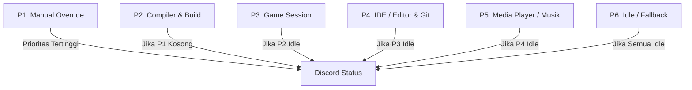

Set-Content -Path "README.md" -Encoding UTF8 -Value @'
<div align="center">

# 🌌 OmniPresence

**Custom Discord Rich Presence Manager berbasis PySide6 & Discord IPC**

[](https://www.python.org/)
[-41CD52.svg?style=flat-square&logo=qt&logoColor=white)](https://www.qt.io/)
[](https://microsoft.com/windows)
[](LICENSE)

<p align="center">
  Aplikasi desktop Windows untuk memperbarui status Discord Rich Presence secara otomatis berdasarkan aktivitas yang sedang berjalan—mulai dari proses kompilasi kode, teks editor/IDE, sesi game, hingga lagu yang sedang diputar.
</p>

[Fitur](#-fitur) • [Hierarki Prioritas](#-hierarki-prioritas) • [Cara Pasang & Jalankan](#-cara-pasang--jalankan) • [Compile ke .EXE](#-compile-ke-exe) • [Konfigurasi](#-konfigurasi) • [Struktur Proyek](#-struktur-proyek)

---

</div>

## 🚀 Fitur

- **Cover Album Musik Dinamis:** Otomatis mengambil dan menampilkan gambar cover album resolusi tinggi di Discord saat memutar lagu (Spotify, browser, pemutar lokal) tanpa perlu setup Spotify Developer API key.
- **Deteksi Identitas Akun Otomatis:** Membaca username dan inisial avatar langsung dari payload handshake Discord IPC (`READY`). Tidak ada lagi nama yang di-hardcode.
- **Sistem Prioritas Pintar:** Status Discord berganti mulus tanpa saling tumpang tindih (misal: saat compile atau bermain game, status musik di latar belakang otomatis mengalah).
- **Deteksi Konteks Git & Editor:** Menampilkan nama file, proyek, dan branch Git aktif saat menggunakan editor seperti Code::Blocks atau VS Code.
- **Compiler Watcher:** Mendeteksi eksekusi compiler (`gcc`, `g++`, `clang`, `make`, `cmake`, `ninja`, dll.) dan menampilkan status build secara real-time.
- **Live Preview & Telemetri:** Mockup kartu Discord interaktif dan pemantau beban CPU/RAM langsung di titlebar aplikasi.
- **Siap Jadi File `.exe` Mandiri:** Dilengkapi script build satu-klik untuk membundel aplikasi menjadi file executable tanpa jendela hitam terminal (*silent GUI*).

---

## 🧭 Hierarki Prioritas

OmniPresence mengecek aplikasi aktif secara berkala dan menentukan status mana yang berhak tampil di profil Discord berdasarkan urutan tier:



| Tier | Kategori | Contoh Trigger | Output Status di Discord |
| --- | --- | --- | --- |
| **P1** | **Manual Override** | Diaktifkan manual dari bar kontrol | Mengunci status kustom pilihan sendiri |
| **P2** | **Compiler Active** | `gcc.exe`, `g++.exe`, `ninja.exe` | `Compiling: main.cpp` + durasi build |
| **P3** | **Gaming Mode** | Minecraft, game Steam/fullscreen | Nama game & lama waktu bermain |
| **P4** | **IDE & Editor** | Code::Blocks, VS Code | `Editing: app.cpp` • `Git: main` |
| **P5** | **Media Scrobbler** | Spotify, YouTube Music via browser | `Listening to: [Lagu] by [Artis]` + Album Art |
| **P6** | **Idle** | Tidak ada proses utama aktif | Status standby / netral |

---

## 💻 Cara Pasang & Jalankan

### Prasyarat

* **Windows 10 / 11** (64-bit)
* **Python 3.11+**
* Aplikasi **Discord Desktop** (atau Vesktop dengan RPC aktif)

### 1. Clone Repositori

```powershell
git clone [https://github.com/Raf446/OmniPresence.git](https://github.com/Raf446/OmniPresence.git)
cd OmniPresence

```

### 2. Install Dependensi

```powershell
pip install -r requirements.txt

```

### 3. Jalankan Aplikasi

```powershell
# Menjalankan aplikasi normal
python main.py

# Menjalankan langsung terminimalkan ke System Tray
python main.py --minimized

```

---

## 📦 Compile ke .EXE

Untuk membuat file executable mandiri (`OmniPresence.exe`) yang bisa dijalankan langsung di PC lain tanpa perlu install Python:

```powershell
.\build.bat

```

Script akan otomatis menyiapkan PyInstaller, membuat ikon aplikasi, dan mengompilasi proyek. File hasil kompilasi siap pakai akan berada di folder:

```text
dist\OmniPresence.exe

```

---

## ⚙️ Konfigurasi

### Pengaturan Umum (`config/settings.json`)

```json
{
  "discord_client_id": "1560465175188996176",
  "discord_app_name": "OmniPresence",
  "profile_display_name": "",
  "profile_handle": "",
  "poll_interval_seconds": 2.5,
  "start_minimized": false
}

```

* Biarkan `profile_display_name` dan `profile_handle` kosong (`""`) agar aplikasi mendeteksi nama dan handle akun Discord kamu secara otomatis. Isi jika ingin memakai nama custom di kartu preview.

### Aturan Deteksi (`config/rules.json`)

Setiap rule diatur dalam format JSON sederhana:

```json
{
  "id": "codeblocks_editor",
  "name": "Code::Blocks IDE",
  "priority": "P4",
  "process_names": ["codeblocks.exe"],
  "presence": {
    "details": "Editing: {file}",
    "state": "Project: {target|Workspace}",
    "large_image": "codeblocks",
    "large_text": "Code::Blocks IDE",
    "small_image": "git_badge",
    "small_text": "Branch: {git_branch}"
  }
}

```

---

## 📂 Struktur Proyek

```text
OmniPresence/
├── assets/             # Ikon aplikasi dan stylesheet UI (theme.qss)
├── config/             # settings.json dan rules.json
├── core/
│   ├── ipc_manager.py     # Koneksi socket Discord IPC & sniffer event READY
│   ├── priority_engine.py # Evaluasi prioritas dan pencocokan proses
│   ├── process_watcher.py # Pemantau proses Windows aktif
│   └── state_manager.py   # State store dan reactive signals Qt
├── extractors/
│   ├── git_context.py     # Pembaca metadata repo Git lokal
│   └── media_scrobbler.py # SMTC audio listener & resolver cover album
├── ui/
│   ├── components/        # Discord card preview, rule table, meter telemetri
│   └── main_window.py     # Window utama PySide6
├── build_exe.py        # Script build PyInstaller
├── build.bat           # Automasi build sekali klik untuk Windows
├── requirements.txt    # Daftar dependensi Python
└── main.py             # Entrypoint aplikasi

```

---

## 📄 Lisensi

Proyek ini menggunakan lisensi [MIT](https://www.google.com/search?q=LICENSE). Silakan gunakan, modifikasi, dan kembangkan sesuka hati.
'@

git add README.md
git commit -m "docs: update README with natural tone and flattened project structure"
git push origin main

```

```